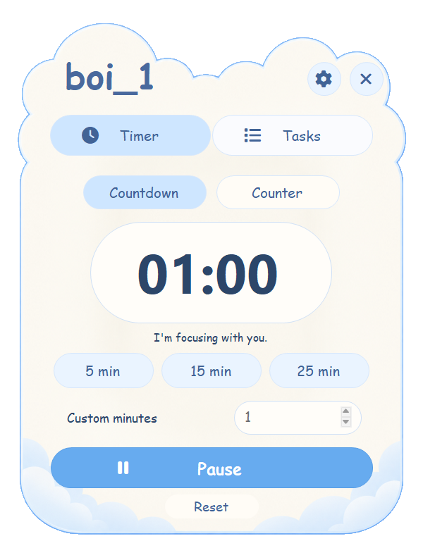

# boi_1 🐾

**A sleepy desktop cat for getting little things done.**

boi lives near the Windows system tray. Click the cat to open a little cloud of tools, start a focus session, or jot down what you want to do next. A clear glass bubble keeps your time in sight while the cat keeps you company.

<p align="center">
  
  
</p>

## What boi can do

| Feature | How it works |
| --- | --- |
| **Focus timer** | Pick 5, 15, or 25 minutes, or set your own duration. The corner bubble shows the countdown while you work. |
| **Session counter** | Switch to **Counter** to count up from the start of a session. Pause, resume, or reset whenever you like. |
| **Little to-do list** | Add, edit, and check off tasks. You can reopen finished tasks or undo the last deletion. |
| **Eye breaks** | Turn on a reminder to look into the distance for 20 seconds every 20 minutes. |
| **Desktop company** | boi blinks, reacts, and gets sleepy. Try the expressions in Settings or turn on reduced motion. |

Click the bubble to open the timer. Hover over it and click **×** to tuck it away while your session keeps running. Restore it in Settings. Right-click the cat or its tray icon for quick controls, or press **Ctrl + Alt + B** to open the tools.

## Try it on Windows

This is an unsigned hobby project for Windows with .NET Framework 4.8.

1. Clone this repository or choose **Code → Download ZIP** and extract it.
2. Open PowerShell in the project folder and run:

   ```powershell
   ./build.ps1
   ```

3. Open `dist/cat/boi_1.exe`. Keep its `assets` folder beside it. Use `Open-boi-tools.exe` in the same folder to open the tools directly.

If you have an older copy running, choose **Quit boi_1** from its tray menu before launching a new build. Run `./package.ps1` to make a portable ZIP locally.

## A few details

- boi works offline. Tasks and preferences stay on your PC under `%LOCALAPPDATA%\boi_1`.
- The overlay lives on the primary monitor and can stay visible over borderless fullscreen apps. Exclusive fullscreen apps may cover it.
- The cat is stationary between expressions while the walk cycle is being refined.

## Behind the project

boi_1 is built in C# with Windows Forms and native layered windows. Run `./test.ps1` for the core checks. The app’s `--smoke-test` option uses sample data and exercises the timer, counter, and task controls.

[Credits](CREDITS.md) · [Design notes](docs/DESKTOP-PET.md) · [QA notes](design-qa.md) · [Report an issue](https://github.com/SuwajAryal/boi_1/issues)

A project-wide license has yet to be selected. See the credits for third-party terms.
